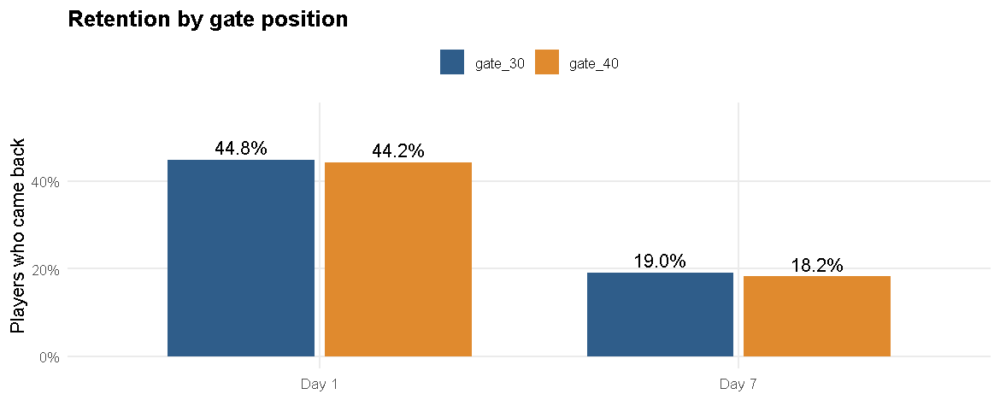
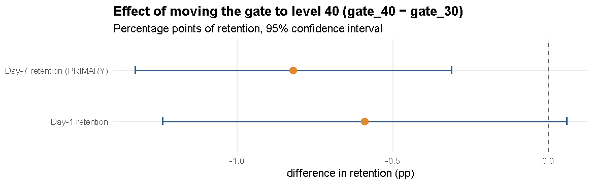
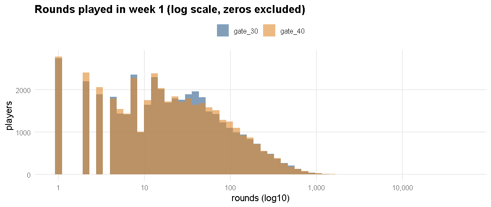
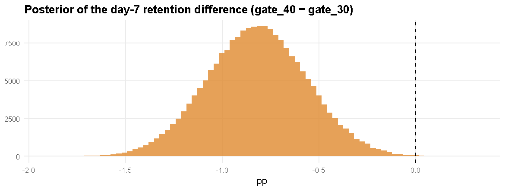
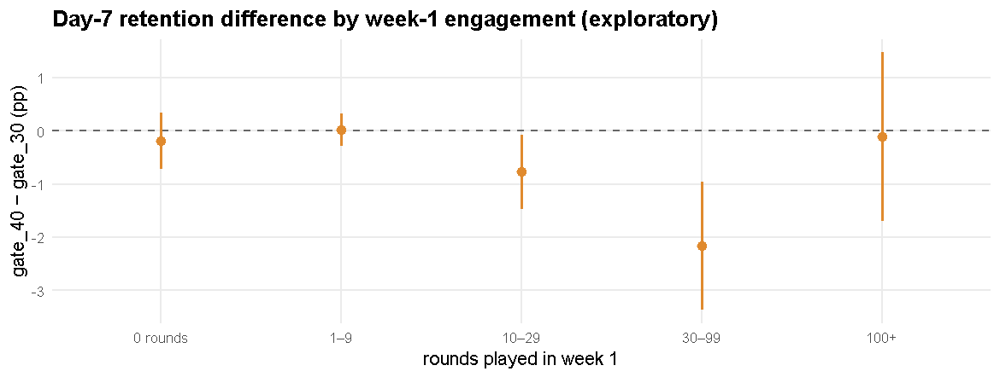

# A/B Test Analysis — Cookie Cats: moving the first gate from level 30 to level 40

*Author: Anurag Moyal*


# 1. Business question

*Cookie Cats* is a mobile puzzle game. At certain levels a **gate** forces players to wait (or pay) before continuing. The product team asks:

> **If we move the first gate from level 30 to level 40, do we keep more players coming back?**

Moving the gate later could keep players engaged longer — or remove a natural pause that makes the game feel less urgent. The experiment randomised new
players into **gate_30** (control, the current game) or **gate_40** (treatment).

**Decision to make:** ship the change to everyone, or keep it as it is.

## Pre-specified analysis plan
Written *before* looking at results, to avoid cherry-picking:

| | Metric | Why |
|---|---|---|
| **Primary** | **Day-7 retention** (`retention_7`): did the player play again 7 days after install? | Retention is the lifeblood of a free-to-play game, and day 7 captures whether the gate hurt long-term habit, not just curiosity |
| Secondary | Day-1 retention (`retention_1`) | Early signal; less sensitive to a level-30/40 gate because most players have not reached it yet |
| Guardrail | Game rounds played in week 1 (`sum_gamerounds`) | Engagement volume; a retention win bought with fewer rounds would be suspicious |

* Significance level α = 5 % (two-sided); the three metrics are also adjusted with the Holm correction.
* Effect sizes and **confidence intervals** are reported next to every p-value.
* Null hypothesis for each metric: the two gate positions give the same result.

# 2. Data & quality checks


``` r
d <- read_csv("data/raw/cookie_cats.csv", show_col_types = FALSE) |>
  mutate(version = factor(version, levels = c("gate_30", "gate_40")), retention_1 = as.integer(retention_1), retention_7 = as.integer(retention_7))
glimpse(d)
```

```
## Rows: 90,189
## Columns: 5
## $ userid         <dbl> 116, 337, 377, 483, 488, 540, 1066, 1444, 1574, 1587, 1…
## $ version        <fct> gate_30, gate_30, gate_40, gate_40, gate_40, gate_40, g…
## $ sum_gamerounds <dbl> 3, 38, 165, 1, 179, 187, 0, 2, 108, 153, 3, 0, 30, 39, …
## $ retention_1    <int> 0, 1, 1, 0, 1, 1, 0, 0, 1, 1, 0, 0, 1, 1, 1, 1, 1, 1, 1…
## $ retention_7    <int> 0, 0, 0, 0, 1, 1, 0, 0, 1, 0, 1, 0, 0, 0, 1, 0, 0, 1, 1…
```


``` r
tibble(
  check = c("Rows (players)", "Duplicate user IDs", "Missing values", "Players with 0 rounds (installed, never played)",
            "Max rounds by one player", "99.9th percentile of rounds", "Players with day-7 retention but not day-1"),
  value = c(nrow(d), sum(duplicated(d$userid)), sum(is.na(d)), sum(d$sum_gamerounds == 0), max(d$sum_gamerounds),
            round(quantile(d$sum_gamerounds, .999)), sum(d$retention_7 == 1 & d$retention_1 == 0))
) |> kable(format.args = list(big.mark = ","))
```


|check                                           |  value|
|:-----------------------------------------------|------:|
|Rows (players)                                  | 90,189|
|Duplicate user IDs                              |      0|
|Missing values                                  |      0|
|Players with 0 rounds (installed, never played) |  3,994|
|Max rounds by one player                        | 49,854|
|99.9th percentile of rounds                     |  1,074|
|Players with day-7 retention but not day-1      |  3,599|

**Findings.** No duplicates or missing values. One player logged **49,854 rounds** in a week (the next highest is 2,961) — almost certainly a bot or
data error; it will wreck any mean-based comparison of rounds, so we test rounds with outlier-robust methods and show a sensitivity analysis.
3,994 players ( 4.4% ) installed but never played; they are kept
(they are part of the randomised population).

## Sample-ratio mismatch (SRM) check
If randomisation worked, the two groups should be about equal in size. A significant imbalance suggests a bug in assignment or logging.


``` r
n_by <- table(d$version); srm <- srm_check(n_by[["gate_30"]], n_by[["gate_40"]])
print(n_by); srm
```

```
## 
## gate_30 gate_40 
##   44700   45489
```

```
## 
## 	Chi-squared test for given probabilities
## 
## data:  c(n_control, n_treat)
## X-squared = 6.9, df = 1, p-value = 0.0086
```

**This is a warning sign:** 44,700 vs 45,489 players
(50.4% in gate_40, SRM p = 0.0086). A 0.9 % imbalance this size would occur by chance less than
1 time in 100 if assignment really were 50/50. We cannot tell from the data *why* (e.g. logging loss in one arm). So we proceed **with the caveat
stated**, and §8 tests whether the conclusion survives when the groups are forced to equal size.

# 3. Descriptive comparison


``` r
desc <- d |> group_by(version) |>
  summarise(players = n(), day1_retention = mean(retention_1), day7_retention = mean(retention_7),
            mean_rounds = mean(sum_gamerounds), median_rounds = median(sum_gamerounds), p99_rounds = quantile(sum_gamerounds, .99))
desc |> mutate(across(c(day1_retention, day7_retention), ~ percent(.x, .01))) |> kable(digits = 1, format.args = list(big.mark = ","))
```


|version | players|day1_retention |day7_retention | mean_rounds| median_rounds| p99_rounds|
|:-------|-------:|:--------------|:--------------|-----------:|-------------:|----------:|
|gate_30 |  44,700|44.82%         |19.02%         |        52.5|            17|      493.0|
|gate_40 |  45,489|44.23%         |18.20%         |        51.3|            16|      492.1|


``` r
d |> group_by(version) |> summarise(`Day 1` = mean(retention_1), `Day 7` = mean(retention_7)) |>
  pivot_longer(-version, names_to = "metric", values_to = "rate") |>
  ggplot(aes(metric, rate, fill = version)) + geom_col(position = position_dodge(.75), width = .7) +
  geom_text(aes(label = percent(rate, .1)), position = position_dodge(.75), vjust = -.4) +
  scale_fill_manual(values = COL) + scale_y_continuous(labels = percent, limits = c(0, .55)) +
  labs(title = "Retention by gate position", x = NULL, y = "Players who came back", fill = NULL) + theme_ab()
```



# 4. Hypothesis tests on retention

Two-proportion z-tests (pooled variance for the p-value, Wald interval for the CI). *Difference = gate_40 − gate_30.*


``` r
cnt <- d |> group_by(version) |> summarise(n = n(), r1 = sum(retention_1), r7 = sum(retention_7))
c30 <- filter(cnt, version == "gate_30"); c40 <- filter(cnt, version == "gate_40")
res7 <- prop_compare(c30$r7, c30$n, c40$r7, c40$n)
res1 <- prop_compare(c30$r1, c30$n, c40$r1, c40$n)
ret_tab <- bind_rows(`Day-7 retention (PRIMARY)` = res7, `Day-1 retention` = res1, .id = "metric")
ret_tab |> transmute(metric, control = percent(control, .01), treatment = percent(treatment, .01),
                     `diff (pp)` = round(diff_pp, 2), `95% CI (pp)` = sprintf("[%.2f, %.2f]", ci_low_pp, ci_high_pp),
                     `relative lift` = sprintf("%.1f%%", rel_lift_pct), `odds ratio` = round(odds_ratio, 3), `Cohen's h` = round(cohens_h, 3),
                     z = round(z, 2), `p-value` = fmt_p(p_value)) |> kable()
```


|metric                    |control |treatment | diff (pp)|95% CI (pp)    |relative lift | odds ratio| Cohen's h|     z|p-value |
|:-------------------------|:-------|:---------|---------:|:--------------|:-------------|----------:|---------:|-----:|:-------|
|Day-7 retention (PRIMARY) |19.02%  |18.20%    |     -0.82|[-1.33, -0.31] |-4.3%         |      0.947|    -0.021| -3.16|0.0016  |
|Day-1 retention           |44.82%  |44.23%    |     -0.59|[-1.24, 0.06]  |-1.3%         |      0.976|    -0.012| -1.78|0.0744  |


``` r
ret_tab |> ggplot(aes(diff_pp, metric)) + geom_vline(xintercept = 0, linetype = 2, color = "grey40") +
  geom_errorbarh(aes(xmin = ci_low_pp, xmax = ci_high_pp), height = .15, linewidth = 1, color = COL[["gate_30"]]) +
  geom_point(size = 3.5, color = COL[["gate_40"]]) +
  labs(title = "Effect of moving the gate to level 40 (gate_40 − gate_30)", subtitle = "Percentage points of retention, 95% confidence interval",
       x = "difference in retention (pp)", y = NULL) + theme_ab()
```



**Reading.** For the primary metric, day-7 retention falls from **19.02%** to **18.20%**
(-0.82 pp; 95 % CI [-1.33, -0.31]; p = 0.0016).
The whole interval is below zero. For day-1 retention the difference (-0.59 pp, p = 0.0744) is
not significant at 5 %: it points the same way but is smaller, as expected, because most players have not
reached a level-30 gate on day 1.

## Logistic regression (same result, as a model)

``` r
m7 <- glm(retention_7 ~ version, data = d, family = binomial())
tidy(m7, exponentiate = TRUE, conf.int = TRUE) |> mutate(across(where(is.numeric), ~ round(.x, 4))) |> kable()
```


|term           | estimate| std.error| statistic| p.value| conf.low| conf.high|
|:--------------|--------:|---------:|---------:|-------:|--------:|---------:|
|(Intercept)    |   0.2349|    0.0121| -120.2066|  0.0000|   0.2294|    0.2405|
|versiongate_40 |   0.9473|    0.0171|   -3.1641|  0.0016|   0.9160|    0.9796|
The `versiongate_40` odds ratio below 1 says the odds of coming back after 7 days are lower with the later gate — consistent with the z-test.

# 5. Engagement (guardrail): game rounds are heavy-tailed


``` r
ggplot(d |> filter(sum_gamerounds > 0), aes(sum_gamerounds, fill = version)) +
  geom_histogram(bins = 60, alpha = .6, position = "identity") + scale_x_log10(labels = comma) + scale_fill_manual(values = COL) +
  labs(title = "Rounds played in week 1 (log scale, zeros excluded)", x = "rounds (log10)", y = "players", fill = NULL) + theme_ab()
```



A t-test on raw means is unreliable (skewed data with a 49,854-round outlier), so we use several robust methods and check they agree:


``` r
x30 <- d$sum_gamerounds[d$version == "gate_30"]; x40 <- d$sum_gamerounds[d$version == "gate_40"]
mw <- wilcox.test(x40, x30, conf.int = TRUE)
tl <- t.test(log1p(x40), log1p(x30))
bm <- boot_diff(x30, x40, mean); bd <- boot_diff(x30, x40, median)
x30w <- pmin(x30, quantile(d$sum_gamerounds, .999)); x40w <- pmin(x40, quantile(d$sum_gamerounds, .999))
bw <- boot_diff(x30w, x40w, mean)
tibble(method = c("Mann-Whitney U (location shift, pseudo-median)", "Welch t-test on log(1 + rounds)", "Bootstrap difference in MEAN (raw)",
                  "Bootstrap difference in MEAN (winsorised at 99.9th pct)", "Bootstrap difference in MEDIAN"),
       estimate = c(unname(mw$estimate), unname(tl$estimate[1] - tl$estimate[2]), bm[["estimate"]], bw[["estimate"]], bd[["estimate"]]),
       ci_low = c(mw$conf.int[1], tl$conf.int[1], bm[[2]], bw[[2]], bd[[2]]),
       ci_high = c(mw$conf.int[2], tl$conf.int[2], bm[[3]], bw[[3]], bd[[3]]),
       p_value = c(mw$p.value, tl$p.value, bm[["p_two_sided"]], bw[["p_two_sided"]], bd[["p_two_sided"]])) |>
  mutate(across(c(estimate, ci_low, ci_high), ~ round(.x, 3)), p_value = fmt_p(p_value)) |> kable()
```


|method                                                  | estimate| ci_low| ci_high|p_value |
|:-------------------------------------------------------|--------:|------:|-------:|:-------|
|Mann-Whitney U (location shift, pseudo-median)          |    0.000|  0.000|   0.000|0.0502  |
|Welch t-test on log(1 + rounds)                         |   -0.018| -0.038|   0.001|0.0696  |
|Bootstrap difference in MEAN (raw)                      |   -1.157| -4.149|   0.993|0.3676  |
|Bootstrap difference in MEAN (winsorised at 99.9th pct) |   -0.096| -1.382|   1.187|0.8948  |
|Bootstrap difference in MEDIAN                          |   -1.000| -1.000|   0.000|0.1476  |

*(Difference = gate_40 − gate_30. The Mann-Whitney estimate and the median are 0 or ±1 because rounds are whole numbers with many ties.)*


**Reading.** All five methods agree: **no statistically significant difference in rounds played at the 5 % level** (smallest p = 0.0502;
Mann-Whitney is borderline at p = 0.0502). The point estimates lean slightly towards *fewer* rounds with gate_40 (about
-1.2 rounds per player on the raw mean, 2.2% of the average), which is consistent with — but
too small to confirm — the retention drop. The single 49,854-round player inflates gate_30's raw mean by about
1.1 rounds; once the outlier is capped (winsorised row) the difference shrinks to
-0.10. That is why mean-based comparisons on this metric should not be trusted without outlier handling.

# 6. Bayesian view: how likely is gate_40 to be better?

Frequentist p-values do not say "how probable is it that the new gate is better". A Beta-Binomial model (flat priors) does:


``` r
b7 <- bayes_prop(c30$r7, c30$n, c40$r7, c40$n); b1 <- bayes_prop(c30$r1, c30$n, c40$r1, c40$n)
tibble(metric = c("Day-7 retention", "Day-1 retention"), `P(gate_40 better)` = percent(c(b7$prob_treat_better, b1$prob_treat_better), .1),
       `95% credible interval (pp)` = c(sprintf("[%.2f, %.2f]", b7$cred[1] * 100, b7$cred[2] * 100), sprintf("[%.2f, %.2f]", b1$cred[1] * 100, b1$cred[2] * 100)),
       `expected loss if we ship (pp)` = round(c(b7$expected_loss_ship, b1$expected_loss_ship) * 100, 3),
       `expected loss if we keep gate_30 (pp)` = round(c(b7$expected_loss_keep, b1$expected_loss_keep) * 100, 4)) |> kable()
```


|metric          |P(gate_40 better) |95% credible interval (pp) | expected loss if we ship (pp)| expected loss if we keep gate_30 (pp)|
|:---------------|:-----------------|:--------------------------|-----------------------------:|-------------------------------------:|
|Day-7 retention |0.1%              |[-1.33, -0.31]             |                         0.820|                                0.0001|
|Day-1 retention |3.7%              |[-1.24, 0.05]              |                         0.595|                                0.0049|


``` r
tibble(diff = b7$diff * 100) |> ggplot(aes(diff)) + geom_histogram(bins = 80, fill = COL[["gate_40"]], alpha = .8) +
  geom_vline(xintercept = 0, linetype = 2) + labs(title = "Posterior of the day-7 retention difference (gate_40 − gate_30)", x = "pp", y = NULL) + theme_ab()
```



There is a **0.1%** chance that gate_40 is better on day-7 retention, i.e. a **99.9%** chance it is worse.

# 7. Multiple testing

We looked at three metrics, so the chance of at least one false alarm is higher than 5 %. Holm's step-down correction controls that:


``` r
pv <- c(`Day-7 retention` = res7$p_value, `Day-1 retention` = res1$p_value, `Rounds (Mann-Whitney)` = mw$p.value)
tibble(metric = names(pv), raw_p = fmt_p(pv), holm_adjusted_p = fmt_p(p.adjust(pv, "holm")),
       `significant at 5% after adjustment` = ifelse(p.adjust(pv, "holm") < .05, "yes", "no")) |> kable()
```


|metric                |raw_p  |holm_adjusted_p |significant at 5% after adjustment |
|:---------------------|:------|:---------------|:----------------------------------|
|Day-7 retention       |0.0016 |0.0047          |yes                                |
|Day-1 retention       |0.0744 |0.1004          |no                                 |
|Rounds (Mann-Whitney) |0.0502 |0.1004          |no                                 |

# 8. Robustness checks

**(a) Sample-ratio mismatch.** Randomly drop users from the larger arm so both arms have equal size, and repeat 1,000 times:


``` r
set.seed(1)
n30 <- c30$n
sims <- replicate(1000, {
  s40 <- d |> filter(version == "gate_40") |> slice_sample(n = n30)
  r <- prop_compare(c30$r7, n30, sum(s40$retention_7), n30); c(diff = r$diff_pp, p = r$p_value)
})
sims <- as_tibble(t(sims))
tibble(`median diff (pp)` = median(sims$diff), `share of runs with p < 0.05` = percent(mean(sims$p < .05), .1), `median p` = fmt_p(median(sims$p))) |> kable()
```


| median diff (pp)|share of runs with p < 0.05 |median p |
|----------------:|:---------------------------|:--------|
|         -0.82103|100.0%                      |0.0016   |

**(b) Fixed-rule alternative:** a permutation test on day-7 retention (shuffle the group labels 10,000 times):


``` r
set.seed(7)
obs <- res7$diff_pp / 100
perm <- replicate(10000, { v <- sample(d$version); mean(d$retention_7[v == "gate_40"]) - mean(d$retention_7[v == "gate_30"]) })
tibble(`observed diff` = round(obs, 5), `permutation p (two-sided)` = fmt_p(mean(abs(perm) >= abs(obs)))) |> kable()
```


| observed diff|permutation p (two-sided) |
|-------------:|:-------------------------|
|       -0.0082|0.0015                    |

# 9. Where does the effect come from? (exploratory)

The gate only affects players who actually *reach* it. Players who quit in the first few rounds never see it, which dilutes the average effect.
Splitting by week-1 engagement is **post-hoc and exploratory** (engagement is itself measured after randomisation, so treat it as a clue, not a proof):


``` r
seg <- d |> mutate(band = cut(sum_gamerounds, c(-1, 0, 9, 29, 99, Inf), labels = c("0 rounds", "1–9", "10–29", "30–99", "100+"))) |>
  group_by(band) |> summarise(n30 = sum(version == "gate_30"), n40 = sum(version == "gate_40"),
                              r30 = sum(retention_7[version == "gate_30"]), r40 = sum(retention_7[version == "gate_40"]), .groups = "drop") |>
  rowwise() |> mutate(res = list(prop_compare(r30, n30, r40, n40))) |> unnest(res) |> ungroup() |>
  mutate(p_holm = p.adjust(p_value, "holm"))
seg |> transmute(band, players = n30 + n40, `gate_30` = percent(control, .1), `gate_40` = percent(treatment, .1), `diff (pp)` = round(diff_pp, 2),
                 `95% CI (pp)` = sprintf("[%.2f, %.2f]", ci_low_pp, ci_high_pp), p = fmt_p(p_value), `p (Holm)` = fmt_p(p_holm)) |> kable(format.args = list(big.mark = ","))
```


|band     | players|gate_30 |gate_40 | diff (pp)|95% CI (pp)    |p      |p (Holm) |
|:--------|-------:|:-------|:-------|---------:|:--------------|:------|:--------|
|0 rounds |   3,994|0.8%    |0.6%    |     -0.19|[-0.72, 0.33]  |0.4704 |1.0000   |
|1–9      |  30,243|1.8%    |1.8%    |      0.02|[-0.28, 0.32]  |0.9011 |1.0000   |
|10–29    |  22,683|8.1%    |7.3%    |     -0.77|[-1.47, -0.08] |0.0296 |0.1183   |
|30–99    |  20,753|27.8%   |25.7%   |     -2.17|[-3.38, -0.97] |0.0004 |0.0021   |
|100+     |  12,516|71.1%   |71.0%   |     -0.11|[-1.70, 1.48]  |0.8910 |1.0000   |


``` r
ggplot(seg, aes(band, diff_pp)) + geom_hline(yintercept = 0, linetype = 2, color = "grey40") +
  geom_pointrange(aes(ymin = ci_low_pp, ymax = ci_high_pp), color = COL[["gate_40"]], linewidth = .9) +
  labs(title = "Day-7 retention difference by week-1 engagement (exploratory)", x = "rounds played in week 1", y = "gate_40 − gate_30 (pp)") + theme_ab()
```




**Reading.** The retention loss is concentrated among players who played **30–99 rounds** in week 1
(-2.17 pp, Holm-adjusted p = 0.0021) — the group that is deep enough to meet the first gate but not yet committed.
Players who quit almost immediately never see the gate (no effect), and the most engaged players (100+ rounds) come back regardless. This is a plausible
mechanism (a clue worth testing with event-level data), not a proven one.

# 10. Summary of evidence


| Question | Answer |
|---|---|
| Was randomisation clean? | **Not perfectly**: sample-ratio mismatch (p = 0.0086); conclusion checked under forced balance |
| Primary metric (day-7 retention) | 19.02% → 18.20% (-0.82 pp, 95% CI [-1.33, -0.31], p = 0.0016) |
| Day-1 retention | -0.59 pp, p = 0.0744 |
| Engagement (rounds) | no significant difference with any of five methods (borderline lean towards fewer rounds) |
| Chance gate_40 is actually better (day 7) | 0.1% |
| Survives multiple-testing correction? | day 7: yes |

See **02 — power, sample size and decision** for the ship / don't-ship recommendation.
