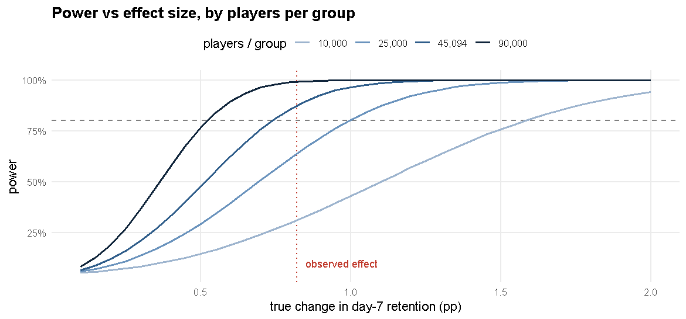

# Sample Size, Power & the Ship / Don't-Ship Decision

*Author: Anurag Moyal*


# 1. Was the experiment big enough? (power & minimum detectable effect)

**Statistical power** is the chance an experiment detects a real effect of a given size. Planning it *before* an experiment prevents the two classic mistakes:
running too small a test (miss real effects) or stopping when the result "looks" significant (false alarms).

* Baseline day-7 retention (control): **19.02%** · Players per group: **45,094** · α = 5 % two-sided · target power = 80 %.


``` r
mde_abs <- function(n, p0, power = .8, alpha = .05) {                       # smallest improvement detectable with this n
  h <- pwr.2p.test(n = n, power = power, sig.level = alpha)$h
  sin((2 * asin(sqrt(p0)) + h) / 2)^2 - p0
}
mde7 <- mde_abs(n_per, p0); mde1 <- mde_abs(n_per, res1$control)
tibble(metric = c("Day-7 retention", "Day-1 retention"), baseline = percent(c(p0, res1$control), .1),
       `players per group` = format(n_per, big.mark = ","),
       `minimum detectable effect, 80% power (pp)` = round(c(mde7, mde1) * 100, 2)) |> kable()
```


|metric          |baseline |players per group | minimum detectable effect, 80% power (pp)|
|:---------------|:--------|:-----------------|-----------------------------------------:|
|Day-7 retention |19.0%    |45,094            |                                      0.74|
|Day-1 retention |44.8%    |45,094            |                                      0.93|

With ~45,094 players per arm the test could reliably detect a change of about **±0.74 pp** in day-7 retention. The observed effect was
**-0.82 pp** — larger than the minimum detectable effect, which is why the test
could and did flag it.

## Sample size needed to detect different effects


``` r
effs <- c(.005, .0075, .01, .015, .02)
need <- expand.grid(mde = effs, power = c(.8, .9)) |> rowwise() |>
  mutate(n_per_group = ceiling(pwr.2p.test(h = ES.h(p0 + mde, p0), power = power, sig.level = .05)$n)) |> ungroup()
need |> mutate(effect = paste0("±", mde * 100, " pp"), `power` = percent(power), `players per group` = format(n_per_group, big.mark = ","),
               `total players` = format(2 * n_per_group, big.mark = ",")) |> select(effect, power, `players per group`, `total players`) |> kable()
```


|effect   |power |players per group |total players |
|:--------|:-----|:-----------------|:-------------|
|±0.5 pp  |80%   |97,679            |195,358       |
|±0.75 pp |80%   |43,625            |87,250        |
|±1 pp    |80%   |24,658            |49,316        |
|±1.5 pp  |80%   |11,063            |22,126        |
|±2 pp    |80%   |6,281             |12,562        |
|±0.5 pp  |90%   |130,765           |261,530       |
|±0.75 pp |90%   |58,402            |116,804       |
|±1 pp    |90%   |33,009            |66,018        |
|±1.5 pp  |90%   |14,810            |29,620        |
|±2 pp    |90%   |8,408             |16,816        |


``` r
grid <- expand.grid(eff = seq(.001, .02, .0005), n = c(10000, 25000, n_per, 90000)) |> rowwise() |>
  mutate(power = pwr.2p.test(h = ES.h(p0 + eff, p0), n = n, sig.level = .05)$power) |> ungroup() |>
  mutate(n_lab = factor(format(n, big.mark = ","), levels = format(sort(unique(n)), big.mark = ",")))
ggplot(grid, aes(eff * 100, power, color = n_lab)) + geom_hline(yintercept = .8, linetype = 2, color = "grey50") +
  geom_vline(xintercept = abs(res7$diff_pp), linetype = 3, color = "#C0392B") + geom_line(linewidth = 1) +
  annotate("text", x = abs(res7$diff_pp) + .03, y = .1, label = "observed effect", color = "#C0392B", hjust = 0, size = 3.5) +
  scale_y_continuous(labels = percent) + scale_color_manual(values = c("#9DB4CE", "#6A93BD", "#2F5D8A", "#10253B")) +
  labs(title = "Power vs effect size, by players per group", x = "true change in day-7 retention (pp)", y = "power", color = "players / group") + theme_ab()
```



# 2. Does our testing procedure behave? (A/A simulation & the cost of peeking)

An **A/A test** compares two *identical* groups. A sound procedure should flag a "significant" difference only ~5 % of the time.


``` r
set.seed(2024)
sim_aa <- function(n, p, looks = 1, B = 2000) {
  inc <- floor(n / looks); sig <- logical(B)
  for (b in seq_len(B)) {
    x1 <- x2 <- 0; hit <- FALSE
    for (k in seq_len(looks)) {
      x1 <- x1 + rbinom(1, inc, p); x2 <- x2 + rbinom(1, inc, p); nk <- k * inc
      pp <- (x1 + x2) / (2 * nk); z <- (x2 / nk - x1 / nk) / sqrt(pp * (1 - pp) * 2 / nk)
      if (abs(z) > qnorm(.975)) { hit <- TRUE; break }
    }
    sig[b] <- hit
  }
  mean(sig)
}
fp <- tibble(procedure = c("One analysis at the planned end (what we did)", "Peek 5 times, stop at first p < 0.05", "Peek 10 times, stop at first p < 0.05", "Peek 30 times, stop at first p < 0.05"),
             looks = c(1, 5, 10, 30)) |> rowwise() |> mutate(false_positive_rate = sim_aa(n_per, p0, looks)) |> ungroup()
fp |> mutate(false_positive_rate = percent(false_positive_rate, .1)) |> select(procedure, `false-positive rate (nominal 5%)` = false_positive_rate) |> kable()
```


|procedure                                     |false-positive rate (nominal 5%) |
|:---------------------------------------------|:--------------------------------|
|One analysis at the planned end (what we did) |4.9%                             |
|Peek 5 times, stop at first p < 0.05          |13.6%                            |
|Peek 10 times, stop at first p < 0.05         |20.0%                            |
|Peek 30 times, stop at first p < 0.05         |28.0%                            |

**Take-away.** A single pre-planned analysis keeps the error rate at 5 %. Repeatedly checking the dashboard and stopping when a result turns significant
multiplies false alarms several-fold — so the plan (sample size, metric, stopping rule) must be fixed in advance; sequential methods are needed if early stopping is wanted.

# 3. What is the business impact?


``` r
per <- 100000
tibble(scenario = c("Keep gate at 30 (control)", "Move gate to 40 (treatment)", "Difference"),
       `retained at day 7 per 100,000 new installs` = c(round(per * res7$control), round(per * res7$treatment), round(per * res7$diff_pp / 100)),
       `95% CI of difference` = c("", "", sprintf("[%s, %s]", format(round(per * res7$ci_low_pp / 100), big.mark = ","), format(round(per * res7$ci_high_pp / 100), big.mark = ",")))) |>
  kable(format.args = list(big.mark = ","))
```


|scenario                    | retained at day 7 per 100,000 new installs|95% CI of difference |
|:---------------------------|------------------------------------------:|:--------------------|
|Keep gate at 30 (control)   |                                     19,020|                     |
|Move gate to 40 (treatment) |                                     18,200|                     |
|Difference                  |                                       -820|[-1,328, -312]       |

Shipping the later gate would cost roughly **820 retained players per 100,000 installs**
(4.3% relative). The financial size depends on what a day-7-retained player is worth — **not in this dataset**, so the table
below is *illustrative only*; replace the value with the real figure from finance:


``` r
tibble(`value of a day-7-retained player (assumption)` = c(0.25, 0.50, 1.00)) |>
  mutate(`revenue impact per 1M installs` = sprintf("-$%s", format(round(abs(res7$diff_pp / 100) * 1e6 * `value of a day-7-retained player (assumption)`), big.mark = ","))) |> kable()
```


| value of a day-7-retained player (assumption)|revenue impact per 1M installs |
|---------------------------------------------:|:------------------------------|
|                                          0.25|-$2,050                        |
|                                          0.50|-$4,101                        |
|                                          1.00|-$8,201                        |

# 4. Decision


| Criterion | Result | Verdict |
|---|---|---|
| Primary metric: day-7 retention | -0.82 pp (95% CI [-1.33, -0.31]), p = 0.0016 | **significant harm** |
| Direction of the whole confidence interval | entirely below zero | gate_40 hurts |
| Secondary: day-1 retention | -0.59 pp, p = 0.0744 | not a reason to ship |
| Guardrail: rounds played | no reliable difference | neutral |
| Bayesian: probability gate_40 is better | 0.1% | very unlikely |
| Robust to multiple testing / permutation / balanced resampling? | Holm-adjusted p stays below 5%; permutation p = 0.0015; 100.0% of balanced resamples significant | yes |
| Experiment validity | sample-ratio mismatch (p = 0.0086): flagged, did not change the conclusion | caveat to investigate |

## Recommendation

> **Do not ship gate_40. Keep the first gate at level 30.**
>
> Moving the gate to level 40 lowers day-7 retention from 19.0% to 18.2%, a relative drop of about
> 4.3 %. The whole confidence interval is below zero, the Bayesian probability that the new gate is better is only
> 0.1%, and nothing in the secondary or guardrail metrics offsets the loss.

*(Numbers in this paragraph are filled in from the analysis.)*

## What would change this decision
* **Monetisation data.** If gate_40 raised revenue per player enough to outweigh the retention loss (it might — gates exist to monetise), the answer changes. This
  dataset has no revenue, so the recommendation is *on retention grounds only*.
* **Longer-term retention** (day 14 / 30): a short-term dip might reverse. A follow-up with longer observation would show it.
* **Sample-ratio mismatch:** engineering should find out why the arms are not 50/50 before the result is treated as final.

## Suggested next experiments
1. Gate earlier (e.g. level 20) versus level 30 — the data suggest "later is worse", so test the other direction.
2. Add revenue and ad-impression metrics to the experiment readout.
3. Pre-register a 14-day retention check and a fixed sample size (§1) before launch; use sequential testing if early stopping is needed.


